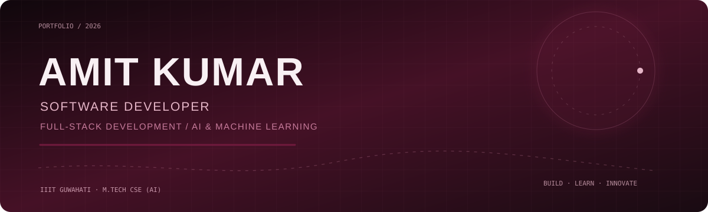

 

**SOFTWARE ENGINEERING · FULL-STACK DEVELOPMENT · ARTIFICIAL INTELLIGENCE**

[Portfolio](https://portfolio-website-new-topaz.vercel.app/) · [LinkedIn](https://www.linkedin.com/in/amit-kumar-79b800256/) · [GitHub](https://github.com/amitkumar97097) · [LeetCode](https://leetcode.com/u/amitraj0/)

---

## 01 / The Developer

### Engineering reliable software. Exploring intelligent systems.

I'm **Amit Kumar**, an M.Tech student specializing in Artificial Intelligence at **IIIT Guwahati**, with a foundation in Computer Science and Engineering from **NERIST**. I work across full-stack development and machine learning, with an interest in turning technical ideas into useful, well-engineered applications.

<table>
<tr>
<td width="33%" valign="top">

**01 / FULL-STACK ENGINEERING**

Building responsive web applications, modular MERN-stack systems, and RESTful services with an emphasis on clean architecture and reliable application workflows.

</td>
<td width="33%" valign="top">

**02 / APPLIED AI & ML**

Working with NLP transformers, BERT, machine learning workflows, and graph learning approaches to explore practical intelligent applications.

</td>
<td width="33%" valign="top">

**03 / PROBLEM SOLVING**

Solved **350+ DSA problems** while strengthening core computer science fundamentals and applying analytical thinking to software engineering challenges.

</td>
</tr>
</table>

**CURRENTLY PURSUING**

**M.Tech · Computer Science and Engineering (Artificial Intelligence)**  
Indian Institute of Information Technology Guwahati · 2026–2028 · **CGPA: 7.6**

---

## 02 / Professional Experience

### Building, experimenting, and shipping.

<table>
<tr>
<td width="33%" valign="top">

**GOOGLE DEVELOPER GROUP · NERIST**

*Web Developer · On-Campus*  
`Jan 2025 – May 2026`

- Engineered responsive web applications using React.js and JavaScript for hundreds of campus users.
- Optimized frontend state management in a four-member Agile team, improving UI performance by **25%**.
- Contributed to web projects and supported developer-focused workshops.

</td>
<td width="33%" valign="top">

**INDIAN INSTITUTE OF TECHNOLOGY GUWAHATI**

*AI / Machine Learning Intern*  
`Jun 2025 – Jul 2025`

- Developed a BERT-based NLP sentiment analysis chatbot using Python and Flask, achieving **92% accuracy**.
- Built data pipelines and performed feature engineering on custom datasets.
- Fine-tuned transformer models for the sentiment classification workflow.

</td>
<td width="33%" valign="top">

**VISIONINTERNZ**

*Full-Stack Development Intern · Remote*  
`May 2023 – Aug 2023`

- Developed full-stack web applications using the MERN stack and modular architecture.
- Designed RESTful APIs with Express.js and MongoDB.
- Managed application deployment workflows using Git and GitHub.

</td>
</tr>
</table>

---

## 03 / Selected Engineering Projects

### From problem definition to working applications.

<table>
<tr>
<td colspan="2" valign="top">

01 / GRAPH MACHINE LEARNING · JUL 2025 – MAY 2026

### Fake Influencer Detection Using ML & GNNs

A graph-based fake-account detection system using the TwiBot-20 dataset, combining account classification with relationship-aware learning.

- **Graph-based detection:** Built a fake-account detection approach using GraphSAGE, achieving an **F1-score of 0.89** on the project dataset.
- **Model comparison:** Evaluated Logistic Regression, Random Forest, GCN, and GraphSAGE for classification performance.
- **Interactive application:** Developed a Streamlit web app for predictive social-profile classification.

`PYTHON` `PYTORCH` `STREAMLIT` `GRAPHSAGE` `TWIBOT-20`

</td>
</tr>
<tr>
<td colspan="2" valign="top">

02 / NATURAL LANGUAGE PROCESSING · MAY 2025 – JUN 2025

### AI Chatbot — Sentiment Analysis

An NLP chatbot that uses a BERT transformer to classify text sentiment and provide real-time inference through a lightweight web application.

- **Transformer modelling:** Built a BERT-based sentiment analysis model, achieving **92% accuracy**.
- **Inference workflow:** Reported inference latency of **under 200 ms** after model integration.
- **Application integration:** Performed text preprocessing and feature engineering, fine-tuned transformer models, and integrated the model with Flask.

`PYTHON` `BERT` `NLP` `FLASK`

</td>
</tr>
<tr>
<td colspan="2" valign="top">

03 / FULL-STACK DEVELOPMENT · DEC 2025 – JAN 2026

### Hotel Reservation System

A full-stack booking platform designed around secure user access, room availability, and reservation management.

- **Secure access:** Implemented JWT authentication and role-based access.
- **Backend services:** Engineered RESTful APIs using Express.js and MongoDB for room availability and user management.
- **Deployment:** Deployed the frontend on Vercel and backend infrastructure on Render.

`REACT.JS` `NODE.JS` `MONGODB` `JWT` `EXPRESS.JS`

</td>
</tr>
</table>

---

## 04 / Technical Toolkit

**PROGRAMMING LANGUAGES**

**FRAMEWORKS & LIBRARIES**

**DATABASES & DEVELOPER TOOLS**

**Core Computer Science:** Data Structures & Algorithms · Object-Oriented Programming · Database Management Systems · Operating Systems · Computer Networks

---

## 05 / Education

| Institution | Qualification | Period | Result |
|---|---|---|---|
| IIIT Guwahati | M.Tech, CSE (Artificial Intelligence) | 2026–2028 | CGPA 7.6 |
| NERIST | B.Tech, Computer Science & Engineering | 2022–2026 | CGPA 7.5 |
| Shivam Vidya Mandir, Patna | Senior Secondary (Class XII) | 2020–2022 | 62.8% |

---

## 06 / Leadership & Community

<table>
<tr>
<td width="50%" valign="top">

**CREATIVITY & DESIGN LEAD**  
*Think India · NERIST Chapter*

- Led digital design initiatives for campus events.
- Supported the visual communication of student-led programs.
- Contributed creative direction to campus activities.

</td>
<td width="50%" valign="top">

**WEB DEVELOPER**  
*Google Developer Group · NERIST*

- Contributed to web development projects.
- Supported developer-focused workshops.
- Engaged with the campus developer community.

</td>
</tr>
</table>

---

## 07 / GitHub & Coding

  

Contribution calendar is supplied by a third-party service. If unavailable, visit the GitHub profile directly.

---

## 08 / Connect

  

**Open to connecting with engineers, builders, and teams working on software and AI.**

Build with purpose. Learn continuously. Keep shipping.

